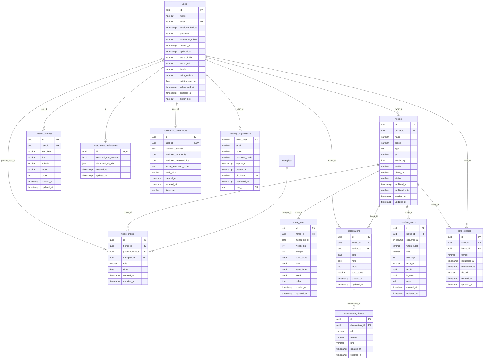
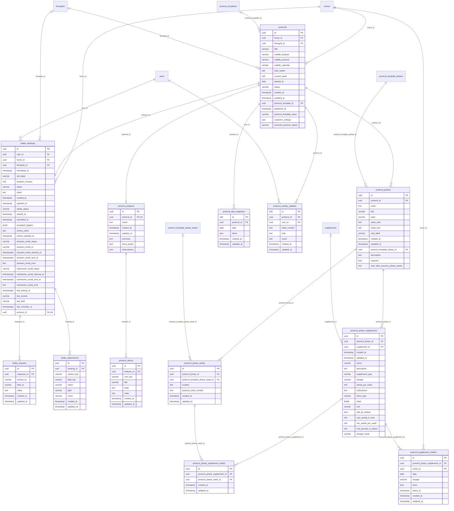
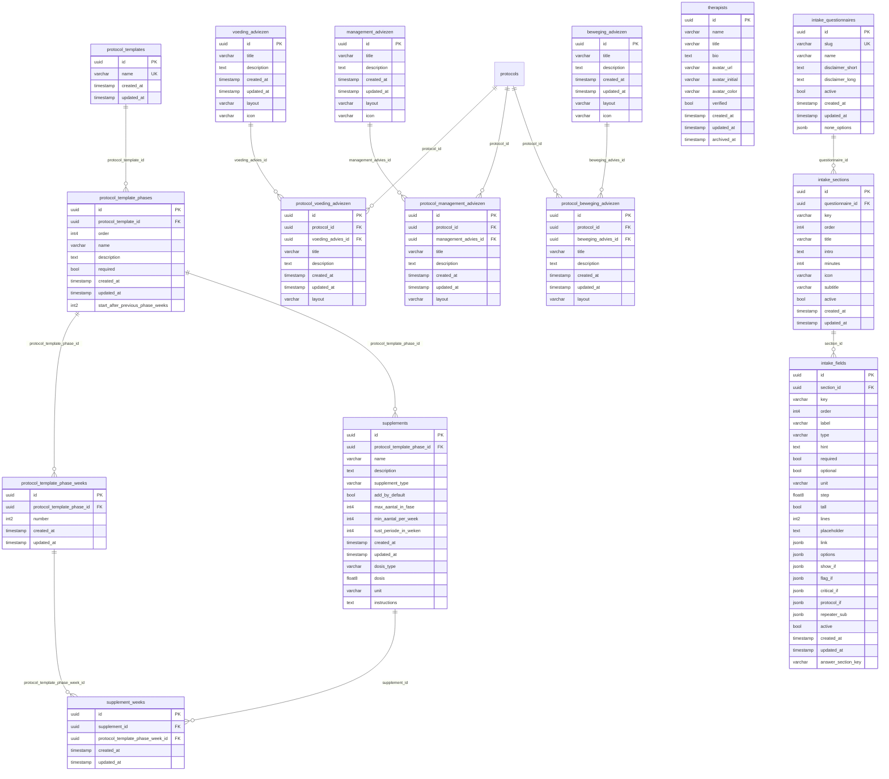
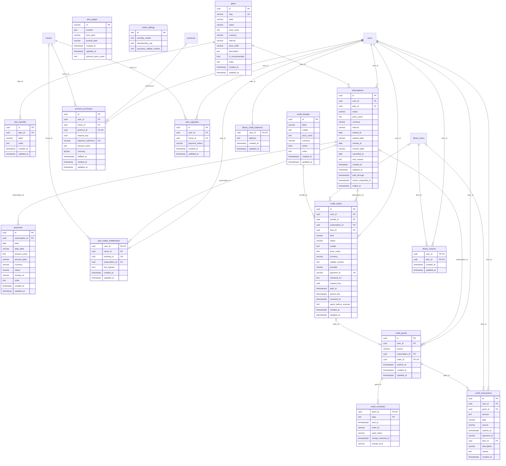
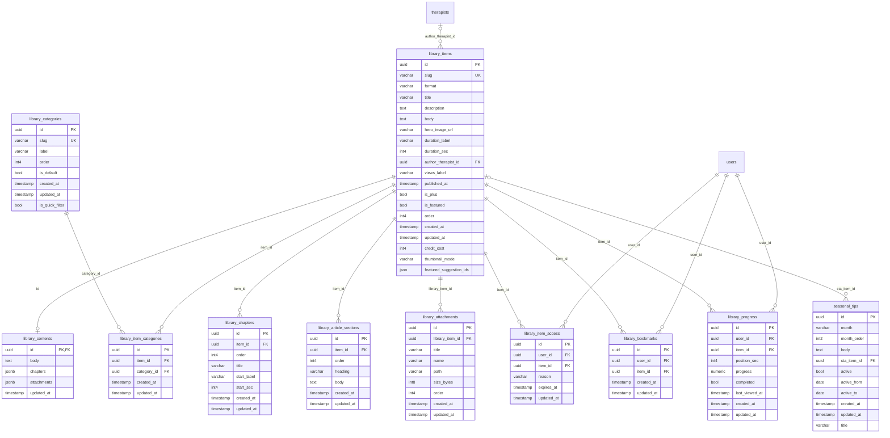
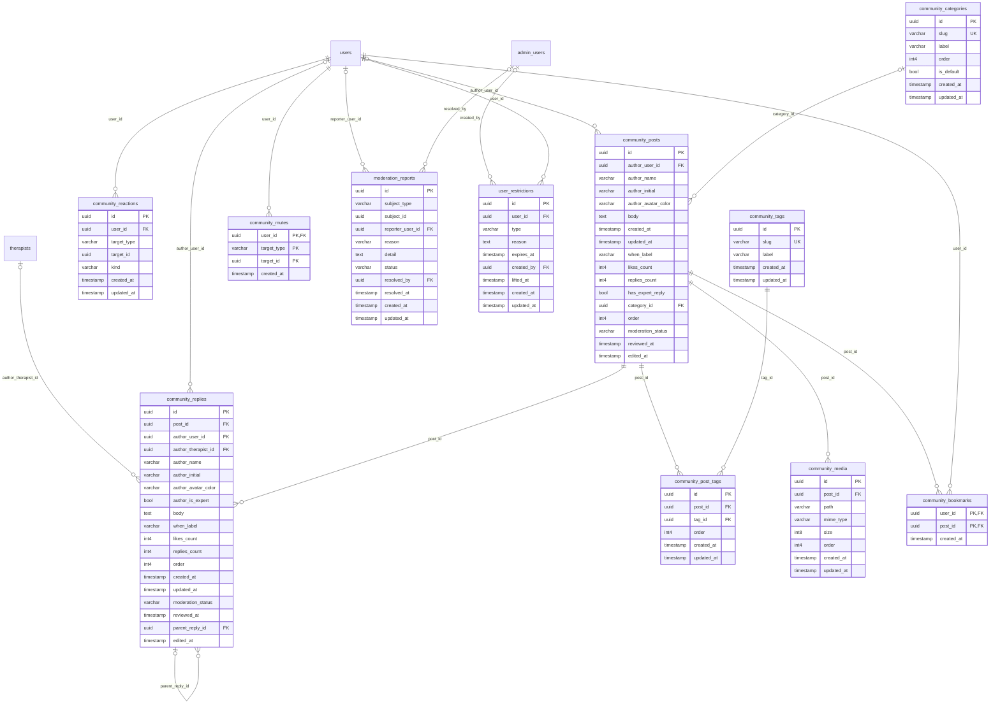
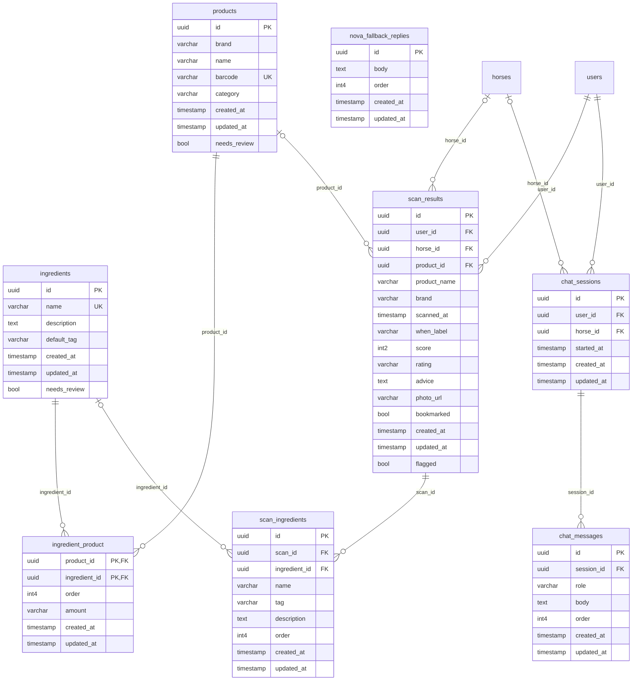

# EquiApp full data model

Schema snapshot after the 2026-10-15 migrations: **101 tables**. Metadata only, no application data. Verified against the migrated test database; existing environments migrate during deployment.

Every table is listed once in its domain. External parent tables reappear in diagrams as references. PK = primary key, FK = foreign key, UQ = single-column unique constraint. `protocols.horse_id` is unique only where status is active. The protocol/intake relationship is exactly 1:1, enforced by a required unique FK plus deferred triggers. Other edges reflect declared database foreign keys. Polymorphic and JSON references are described separately below.

## Accounts and horses

### users

| Column | Type | Nullable | Key |
|---|---|---|---|
| id | uuid | No | PK |
| name | character varying(255) | No |  |
| email | character varying(255) | No | UQ |
| email_verified_at | timestamp(0) without time zone | Yes |  |
| password | character varying(255) | No |  |
| remember_token | character varying(100) | Yes |  |
| created_at | timestamp(0) without time zone | Yes |  |
| updated_at | timestamp(0) without time zone | Yes |  |
| avatar_initial | character varying(4) | Yes |  |
| avatar_url | character varying(255) | Yes |  |
| locale | character varying(16) | No |  |
| units_system | character varying(16) | No |  |
| notifications_on | boolean | No |  |
| onboarded_at | timestamp(0) without time zone | Yes |  |
| disabled_at | timestamp(0) without time zone | Yes |  |
| admin_note | character varying(255) | Yes |  |

### horses

| Column | Type | Nullable | Key |
|---|---|---|---|
| id | uuid | No | PK |
| owner_id | uuid | No | FK |
| name | character varying(255) | No |  |
| breed | character varying(255) | Yes |  |
| age | smallint | Yes |  |
| sex | character varying(16) | Yes |  |
| weight_kg | integer | Yes |  |
| stable | character varying(255) | Yes |  |
| photo_url | character varying(255) | Yes |  |
| status | character varying(16) | No |  |
| archived_at | timestamp(0) without time zone | Yes |  |
| archived_note | character varying(255) | Yes |  |
| created_at | timestamp(0) without time zone | Yes |  |
| updated_at | timestamp(0) without time zone | Yes |  |

- owner_id → users(id) · on delete: cascade

### horse_shares

| Column | Type | Nullable | Key |
|---|---|---|---|
| id | uuid | No | PK |
| horse_id | uuid | No | FK |
| grantee_user_id | uuid | Yes | FK |
| therapist_id | uuid | Yes | FK |
| role | character varying(16) | No |  |
| since | date | Yes |  |
| created_at | timestamp(0) without time zone | Yes |  |
| updated_at | timestamp(0) without time zone | Yes |  |

- grantee_user_id → users(id) · on delete: set null

- horse_id → horses(id) · on delete: cascade

- therapist_id → therapists(id) · on delete: set null

### horse_stats

| Column | Type | Nullable | Key |
|---|---|---|---|
| id | uuid | No | PK |
| horse_id | uuid | No | FK |
| measured_at | date | No |  |
| weight_kg | integer | Yes |  |
| energy | smallint | Yes |  |
| stool_score | character varying(8) | Yes |  |
| label | character varying(255) | Yes |  |
| value_label | character varying(255) | Yes |  |
| trend | character varying(255) | Yes |  |
| order | integer | No |  |
| created_at | timestamp(0) without time zone | Yes |  |
| updated_at | timestamp(0) without time zone | Yes |  |

- horse_id → horses(id) · on delete: cascade

### observations

| Column | Type | Nullable | Key |
|---|---|---|---|
| id | uuid | No | PK |
| horse_id | uuid | No | FK |
| author_id | uuid | No | FK |
| date | date | No |  |
| note | text | Yes |  |
| mood | smallint | Yes |  |
| stool_score | character varying(8) | Yes |  |
| created_at | timestamp(0) without time zone | Yes |  |
| updated_at | timestamp(0) without time zone | Yes |  |

- author_id → users(id) · on delete: cascade

- horse_id → horses(id) · on delete: cascade

### observation_photos

| Column | Type | Nullable | Key |
|---|---|---|---|
| id | uuid | No | PK |
| observation_id | uuid | No | FK |
| url | character varying(255) | No |  |
| caption | character varying(255) | Yes |  |
| kind | character varying(32) | Yes |  |
| created_at | timestamp(0) without time zone | Yes |  |
| updated_at | timestamp(0) without time zone | Yes |  |

- observation_id → observations(id) · on delete: cascade

### timeline_events

| Column | Type | Nullable | Key |
|---|---|---|---|
| id | uuid | No | PK |
| horse_id | uuid | No | FK |
| occurred_at | timestamp(0) without time zone | No |  |
| when_label | character varying(255) | Yes |  |
| kind | character varying(32) | No |  |
| message | text | No |  |
| ref_type | character varying(255) | Yes |  |
| ref_id | uuid | Yes |  |
| is_now | boolean | No |  |
| order | integer | No |  |
| created_at | timestamp(0) without time zone | Yes |  |
| updated_at | timestamp(0) without time zone | Yes |  |

- horse_id → horses(id) · on delete: cascade

### account_settings

| Column | Type | Nullable | Key |
|---|---|---|---|
| id | uuid | No | PK |
| user_id | uuid | No | FK |
| icon_key | character varying(32) | No |  |
| title | character varying(255) | No |  |
| subtitle | character varying(255) | Yes |  |
| route | character varying(255) | Yes |  |
| order | integer | No |  |
| created_at | timestamp(0) without time zone | Yes |  |
| updated_at | timestamp(0) without time zone | Yes |  |

- user_id → users(id) · on delete: cascade

### user_home_preferences

| Column | Type | Nullable | Key |
|---|---|---|---|
| id | uuid | No | PK, FK |
| seasonal_tips_enabled | boolean | No |  |
| dismissed_tip_ids | json | No |  |
| created_at | timestamp(0) without time zone | Yes |  |
| updated_at | timestamp(0) without time zone | Yes |  |

- id → users(id) · on delete: cascade

### notification_preferences

| Column | Type | Nullable | Key |
|---|---|---|---|
| id | uuid | No | PK |
| user_id | uuid | No | FK, UQ |
| reminder_protocol | boolean | No |  |
| reminder_community | boolean | No |  |
| reminder_seasonal_tips | boolean | No |  |
| active_reminders_count | integer | No |  |
| push_token | character varying(255) | Yes |  |
| created_at | timestamp(0) without time zone | Yes |  |
| updated_at | timestamp(0) without time zone | Yes |  |
| timezone | character varying(255) | No |  |

- user_id → users(id) · on delete: cascade

### pending_registrations

| Column | Type | Nullable | Key |
|---|---|---|---|
| token_hash | character varying(64) | No | PK |
| email | character varying(255) | No |  |
| name | character varying(255) | No |  |
| password_hash | character varying(255) | No |  |
| expires_at | timestamp(0) without time zone | No |  |
| created_at | timestamp(0) without time zone | No |  |
| uid_hash | character varying(64) | No | UQ |
| confirmed_at | timestamp(0) without time zone | Yes |  |
| user_id | uuid | Yes | FK |

- user_id → users(id) · on delete: cascade

### data_exports

| Column | Type | Nullable | Key |
|---|---|---|---|
| id | uuid | No | PK |
| user_id | uuid | No | FK |
| horse_id | uuid | Yes | FK |
| format | character varying(8) | No |  |
| requested_at | timestamp(0) without time zone | No |  |
| completed_at | timestamp(0) without time zone | Yes |  |
| file_url | character varying(255) | Yes |  |
| created_at | timestamp(0) without time zone | Yes |  |
| updated_at | timestamp(0) without time zone | Yes |  |

- horse_id → horses(id) · on delete: set null

- user_id → users(id) · on delete: cascade

## Protocols and intake

### protocols

| Column | Type | Nullable | Key |
|---|---|---|---|
| id | uuid | No | PK |
| horse_id | uuid | No | FK |
| therapist_id | uuid | Yes | FK |
| title | character varying(255) | No |  |
| subtitle_analyse | character varying(255) | Yes |  |
| subtitle_protocol | character varying(255) | Yes |  |
| subtitle_calendar | character varying(255) | Yes |  |
| total_weeks | smallint | Yes |  |
| current_week | smallint | Yes |  |
| started_at | date | Yes |  |
| status | character varying(16) | No |  |
| created_at | timestamp(0) without time zone | Yes |  |
| updated_at | timestamp(0) without time zone | Yes |  |
| protocol_template_id | uuid | Yes | FK |
| published_at | timestamp(0) without time zone | Yes |  |
| protocol_template_name | character varying(255) | Yes |  |
| customer_settings | json | Yes |  |
| archived_previous_status | character varying(16) | Yes |  |

- horse_id → horses(id) · on delete: cascade

- protocol_template_id → protocol_templates(id) · on delete: restrict

- therapist_id → therapists(id) · on delete: set null

### intake_bookings

| Column | Type | Nullable | Key |
|---|---|---|---|
| id | uuid | No | PK |
| user_id | uuid | No | FK |
| horse_id | uuid | No | FK |
| therapist_id | uuid | Yes | FK |
| scheduled_at | timestamp(0) without time zone | Yes |  |
| slot_label | character varying(255) | Yes |  |
| duration_minutes | smallint | No |  |
| status | character varying(16) | No |  |
| notes | text | Yes |  |
| created_at | timestamp(0) without time zone | Yes |  |
| updated_at | timestamp(0) without time zone | Yes |  |
| intake_status | character varying(16) | No |  |
| started_at | timestamp(0) without time zone | Yes |  |
| submitted_at | timestamp(0) without time zone | Yes |  |
| accepted_triggers | jsonb | No |  |
| review_notes | text | Yes |  |
| review_updated_at | timestamp(0) without time zone | Yes |  |
| answers_email_status | character varying(255) | Yes |  |
| answers_email_to | character varying(255) | Yes |  |
| answers_email_claimed_at | timestamp(0) with time zone | Yes |  |
| answers_email_sent_at | timestamp(0) with time zone | Yes |  |
| answers_email_error | text | Yes |  |
| submission_email_status | character varying(255) | Yes |  |
| submission_email_claimed_at | timestamp(0) with time zone | Yes |  |
| submission_email_sent_at | timestamp(0) with time zone | Yes |  |
| submission_email_error | text | Yes |  |
| last_activity_at | timestamp(0) with time zone | Yes |  |
| last_section | character varying(64) | Yes |  |
| last_field | character varying(100) | Yes |  |
| last_reminder_at | timestamp(0) with time zone | Yes |  |
| protocol_id | uuid | No | FK, UQ |

- horse_id → horses(id) · on delete: cascade

- protocol_id → protocols(id) · on delete: cascade

- therapist_id → therapists(id) · on delete: restrict

- user_id → users(id) · on delete: cascade

- protocol_id, horse_id → protocols(id, horse_id) · on delete: cascade

### intake_answers

| Column | Type | Nullable | Key |
|---|---|---|---|
| id | uuid | No | PK |
| response_id | uuid | No | FK |
| section_id | character varying(64) | No |  |
| field_id | character varying(64) | No |  |
| value | text | Yes |  |
| created_at | timestamp(0) without time zone | Yes |  |
| updated_at | timestamp(0) without time zone | Yes |  |

- response_id → intake_bookings(id) · on delete: cascade

### intake_attachments

| Column | Type | Nullable | Key |
|---|---|---|---|
| id | uuid | No | PK |
| booking_id | uuid | No | FK |
| section_key | character varying(64) | No |  |
| field_key | character varying(64) | No |  |
| name | character varying(255) | No |  |
| path | character varying(255) | No |  |
| mime | character varying(255) | No |  |
| created_at | timestamp(0) without time zone | Yes |  |
| updated_at | timestamp(0) without time zone | Yes |  |

- booking_id → intake_bookings(id) · on delete: cascade

### protocol_analyses

| Column | Type | Nullable | Key |
|---|---|---|---|
| id | uuid | No | PK |
| protocol_id | uuid | No | FK, UQ |
| cause | text | No |  |
| created_at | timestamp(0) without time zone | Yes |  |
| updated_at | timestamp(0) without time zone | Yes |  |
| summary | text | Yes |  |
| focus_points | json | Yes |  |
| observations | json | Yes |  |

- protocol_id → protocols(id) · on delete: cascade

### protocol_advice

| Column | Type | Nullable | Key |
|---|---|---|---|
| id | uuid | No | PK |
| analysis_id | uuid | No | FK |
| icon_key | character varying(16) | No |  |
| title | character varying(255) | No |  |
| body | text | No |  |
| order | integer | No |  |
| created_at | timestamp(0) without time zone | Yes |  |
| updated_at | timestamp(0) without time zone | Yes |  |

- analysis_id → protocol_analyses(id) · on delete: cascade

### protocol_phases

| Column | Type | Nullable | Key |
|---|---|---|---|
| id | uuid | No | PK |
| protocol_id | uuid | No | FK |
| order | integer | No |  |
| title | character varying(255) | No |  |
| state | character varying(16) | No |  |
| week_start | smallint | Yes |  |
| week_end | smallint | Yes |  |
| chip_label | character varying(255) | Yes |  |
| created_at | timestamp(0) without time zone | Yes |  |
| updated_at | timestamp(0) without time zone | Yes |  |
| protocol_template_phase_id | uuid | No | FK |
| description | text | Yes |  |
| required | boolean | No |  |
| start_after_previous_phase_weeks | smallint | Yes |  |

- protocol_id → protocols(id) · on delete: cascade

- protocol_template_phase_id → protocol_template_phases(id) · on delete: restrict

### protocol_phase_weeks

| Column | Type | Nullable | Key |
|---|---|---|---|
| id | uuid | No | PK |
| protocol_phase_id | uuid | No | FK |
| protocol_template_phase_week_id | uuid | Yes | FK |
| number | integer | No |  |
| protocol_week_number | integer | No |  |
| created_at | timestamp(0) without time zone | Yes |  |
| updated_at | timestamp(0) without time zone | Yes |  |

- protocol_phase_id → protocol_phases(id) · on delete: cascade

- protocol_template_phase_week_id → protocol_template_phase_weeks(id) · on delete: set null

### protocol_phase_supplements

| Column | Type | Nullable | Key |
|---|---|---|---|
| id | uuid | No | PK |
| protocol_phase_id | uuid | No | FK |
| supplement_id | uuid | Yes | FK |
| created_at | timestamp(0) without time zone | Yes |  |
| updated_at | timestamp(0) without time zone | Yes |  |
| name | character varying(255) | Yes |  |
| description | text | Yes |  |
| supplement_type | character varying(255) | Yes |  |
| dosage | character varying(255) | Yes |  |
| aantal_per_week | integer | Yes |  |
| instructions | text | Yes |  |
| dosis_type | character varying(255) | Yes |  |
| dosis | double precision | Yes |  |
| unit | character varying(255) | Yes |  |
| add_by_default | boolean | No |  |
| max_aantal_in_fase | integer | Yes |  |
| min_aantal_per_week | integer | No |  |
| rust_periode_in_weken | integer | No |  |
| dosage_mode | character varying(255) | No |  |

- protocol_phase_id → protocol_phases(id) · on delete: cascade

- supplement_id → supplements(id) · on delete: set null

### protocol_phase_supplement_weeks

| Column | Type | Nullable | Key |
|---|---|---|---|
| id | uuid | No | PK |
| protocol_phase_supplement_id | uuid | No | FK |
| protocol_phase_week_id | uuid | No | FK |
| created_at | timestamp(0) without time zone | Yes |  |
| updated_at | timestamp(0) without time zone | Yes |  |

- protocol_phase_supplement_id → protocol_phase_supplements(id) · on delete: cascade

- protocol_phase_week_id → protocol_phase_weeks(id) · on delete: cascade

### protocol_supplement_intakes

| Column | Type | Nullable | Key |
|---|---|---|---|
| id | uuid | No | PK |
| protocol_phase_supplement_id | uuid | No | FK |
| horse_id | uuid | No | FK |
| date | date | No |  |
| dosage | character varying(255) | Yes |  |
| done | boolean | No |  |
| taken_at | timestamp(0) without time zone | Yes |  |
| created_at | timestamp(0) without time zone | Yes |  |
| updated_at | timestamp(0) without time zone | Yes |  |

- horse_id → horses(id) · on delete: cascade

- protocol_phase_supplement_id → protocol_phase_supplements(id) · on delete: cascade

### protocol_day_snapshots

| Column | Type | Nullable | Key |
|---|---|---|---|
| id | bigint | No | PK |
| protocol_id | uuid | No | FK |
| date | date | No |  |
| items | json | No |  |
| created_at | timestamp(0) without time zone | Yes |  |
| updated_at | timestamp(0) without time zone | Yes |  |

- protocol_id → protocols(id) · on delete: cascade

### protocol_weekly_updates

| Column | Type | Nullable | Key |
|---|---|---|---|
| id | bigint | No | PK |
| protocol_id | uuid | No | FK |
| user_id | uuid | No | FK |
| week_number | integer | No |  |
| note | text | No |  |
| mood | smallint | Yes |  |
| created_at | timestamp(0) without time zone | Yes |  |
| updated_at | timestamp(0) without time zone | Yes |  |

- protocol_id → protocols(id) · on delete: cascade

- user_id → users(id) · on delete: cascade

## Clinical templates and questionnaire

### protocol_templates

| Column | Type | Nullable | Key |
|---|---|---|---|
| id | uuid | No | PK |
| name | character varying(255) | No | UQ |
| created_at | timestamp(0) without time zone | Yes |  |
| updated_at | timestamp(0) without time zone | Yes |  |

### protocol_template_phases

| Column | Type | Nullable | Key |
|---|---|---|---|
| id | uuid | No | PK |
| protocol_template_id | uuid | No | FK |
| order | integer | No |  |
| name | character varying(255) | No |  |
| description | text | Yes |  |
| required | boolean | No |  |
| created_at | timestamp(0) without time zone | Yes |  |
| updated_at | timestamp(0) without time zone | Yes |  |
| start_after_previous_phase_weeks | smallint | Yes |  |

- protocol_template_id → protocol_templates(id) · on delete: cascade

### protocol_template_phase_weeks

| Column | Type | Nullable | Key |
|---|---|---|---|
| id | uuid | No | PK |
| protocol_template_phase_id | uuid | No | FK |
| number | smallint | No |  |
| created_at | timestamp(0) without time zone | Yes |  |
| updated_at | timestamp(0) without time zone | Yes |  |

- protocol_template_phase_id → protocol_template_phases(id) · on delete: cascade

### supplements

| Column | Type | Nullable | Key |
|---|---|---|---|
| id | uuid | No | PK |
| protocol_template_phase_id | uuid | No | FK |
| name | character varying(255) | No |  |
| description | text | Yes |  |
| supplement_type | character varying(255) | No |  |
| add_by_default | boolean | No |  |
| max_aantal_in_fase | integer | Yes |  |
| min_aantal_per_week | integer | No |  |
| rust_periode_in_weken | integer | No |  |
| created_at | timestamp(0) without time zone | Yes |  |
| updated_at | timestamp(0) without time zone | Yes |  |
| dosis_type | character varying(255) | Yes |  |
| dosis | double precision | Yes |  |
| unit | character varying(255) | Yes |  |
| instructions | text | Yes |  |

- protocol_template_phase_id → protocol_template_phases(id) · on delete: cascade

### supplement_weeks

| Column | Type | Nullable | Key |
|---|---|---|---|
| id | uuid | No | PK |
| supplement_id | uuid | No | FK |
| protocol_template_phase_week_id | uuid | No | FK |
| created_at | timestamp(0) without time zone | Yes |  |
| updated_at | timestamp(0) without time zone | Yes |  |

- protocol_template_phase_week_id → protocol_template_phase_weeks(id) · on delete: cascade

- supplement_id → supplements(id) · on delete: cascade

### voeding_adviezen

| Column | Type | Nullable | Key |
|---|---|---|---|
| id | uuid | No | PK |
| title | character varying(255) | No |  |
| description | text | No |  |
| created_at | timestamp(0) without time zone | Yes |  |
| updated_at | timestamp(0) without time zone | Yes |  |
| layout | character varying(32) | No |  |
| icon | character varying(255) | Yes |  |

### management_adviezen

| Column | Type | Nullable | Key |
|---|---|---|---|
| id | uuid | No | PK |
| title | character varying(255) | No |  |
| description | text | No |  |
| created_at | timestamp(0) without time zone | Yes |  |
| updated_at | timestamp(0) without time zone | Yes |  |
| layout | character varying(32) | No |  |
| icon | character varying(255) | Yes |  |

### beweging_adviezen

| Column | Type | Nullable | Key |
|---|---|---|---|
| id | uuid | No | PK |
| title | character varying(255) | No |  |
| description | text | No |  |
| created_at | timestamp(0) without time zone | Yes |  |
| updated_at | timestamp(0) without time zone | Yes |  |
| layout | character varying(32) | No |  |
| icon | character varying(255) | Yes |  |

### protocol_voeding_adviezen

| Column | Type | Nullable | Key |
|---|---|---|---|
| id | uuid | No | PK |
| protocol_id | uuid | No | FK |
| voeding_advies_id | uuid | No | FK |
| title | character varying(255) | No |  |
| description | text | No |  |
| created_at | timestamp(0) without time zone | Yes |  |
| updated_at | timestamp(0) without time zone | Yes |  |
| layout | character varying(32) | No |  |

- protocol_id → protocols(id) · on delete: cascade

- voeding_advies_id → voeding_adviezen(id) · on delete: restrict

### protocol_management_adviezen

| Column | Type | Nullable | Key |
|---|---|---|---|
| id | uuid | No | PK |
| protocol_id | uuid | No | FK |
| management_advies_id | uuid | No | FK |
| title | character varying(255) | No |  |
| description | text | No |  |
| created_at | timestamp(0) without time zone | Yes |  |
| updated_at | timestamp(0) without time zone | Yes |  |
| layout | character varying(32) | No |  |

- management_advies_id → management_adviezen(id) · on delete: restrict

- protocol_id → protocols(id) · on delete: cascade

### protocol_beweging_adviezen

| Column | Type | Nullable | Key |
|---|---|---|---|
| id | uuid | No | PK |
| protocol_id | uuid | No | FK |
| beweging_advies_id | uuid | No | FK |
| title | character varying(255) | No |  |
| description | text | No |  |
| created_at | timestamp(0) without time zone | Yes |  |
| updated_at | timestamp(0) without time zone | Yes |  |
| layout | character varying(32) | No |  |

- beweging_advies_id → beweging_adviezen(id) · on delete: restrict

- protocol_id → protocols(id) · on delete: cascade

### intake_questionnaires

| Column | Type | Nullable | Key |
|---|---|---|---|
| id | uuid | No | PK |
| slug | character varying(255) | No | UQ |
| name | character varying(255) | No |  |
| disclaimer_short | text | Yes |  |
| disclaimer_long | text | Yes |  |
| active | boolean | No |  |
| created_at | timestamp(0) without time zone | Yes |  |
| updated_at | timestamp(0) without time zone | Yes |  |
| none_options | jsonb | No |  |

### intake_sections

| Column | Type | Nullable | Key |
|---|---|---|---|
| id | uuid | No | PK |
| questionnaire_id | uuid | No | FK |
| key | character varying(64) | No |  |
| order | integer | No |  |
| title | character varying(255) | No |  |
| intro | text | Yes |  |
| minutes | integer | No |  |
| icon | character varying(32) | Yes |  |
| subtitle | character varying(255) | Yes |  |
| active | boolean | No |  |
| created_at | timestamp(0) without time zone | Yes |  |
| updated_at | timestamp(0) without time zone | Yes |  |

- questionnaire_id → intake_questionnaires(id) · on delete: cascade

### intake_fields

| Column | Type | Nullable | Key |
|---|---|---|---|
| id | uuid | No | PK |
| section_id | uuid | No | FK |
| key | character varying(64) | No |  |
| order | integer | No |  |
| label | character varying(255) | No |  |
| type | character varying(32) | No |  |
| hint | text | Yes |  |
| required | boolean | No |  |
| optional | boolean | No |  |
| unit | character varying(32) | Yes |  |
| step | double precision | Yes |  |
| tall | boolean | No |  |
| lines | smallint | Yes |  |
| placeholder | text | Yes |  |
| link | jsonb | Yes |  |
| options | jsonb | Yes |  |
| show_if | jsonb | Yes |  |
| flag_if | jsonb | Yes |  |
| critical_if | jsonb | Yes |  |
| protocol_if | jsonb | Yes |  |
| repeater_sub | jsonb | Yes |  |
| active | boolean | No |  |
| created_at | timestamp(0) without time zone | Yes |  |
| updated_at | timestamp(0) without time zone | Yes |  |
| answer_section_key | character varying(64) | Yes |  |

- section_id → intake_sections(id) · on delete: cascade

### therapists

| Column | Type | Nullable | Key |
|---|---|---|---|
| id | uuid | No | PK |
| name | character varying(255) | No |  |
| title | character varying(255) | Yes |  |
| bio | text | Yes |  |
| avatar_url | character varying(255) | Yes |  |
| avatar_initial | character varying(4) | Yes |  |
| avatar_color | character varying(16) | Yes |  |
| verified | boolean | No |  |
| created_at | timestamp(0) without time zone | Yes |  |
| updated_at | timestamp(0) without time zone | Yes |  |
| archived_at | timestamp(0) without time zone | Yes |  |

## Plans payments and credits

### plans

| Column | Type | Nullable | Key |
|---|---|---|---|
| id | uuid | No | PK |
| slug | character varying(255) | No | UQ |
| label | character varying(255) | Yes |  |
| name | character varying(255) | No |  |
| price_cents | integer | No |  |
| currency | character varying(8) | No |  |
| interval | character varying(16) | No |  |
| price_suffix | character varying(255) | Yes |  |
| description | text | Yes |  |
| is_recommended | boolean | No |  |
| order | integer | No |  |
| created_at | timestamp(0) without time zone | Yes |  |
| updated_at | timestamp(0) without time zone | Yes |  |

### plan_benefits

| Column | Type | Nullable | Key |
|---|---|---|---|
| id | uuid | No | PK |
| plan_id | uuid | No | FK |
| label | character varying(255) | No |  |
| order | integer | No |  |
| created_at | timestamp(0) without time zone | Yes |  |
| updated_at | timestamp(0) without time zone | Yes |  |

- plan_id → plans(id) · on delete: cascade

### subscriptions

| Column | Type | Nullable | Key |
|---|---|---|---|
| id | uuid | No | PK |
| user_id | uuid | No | FK |
| plan_id | uuid | No | FK |
| status | character varying(16) | No |  |
| price_cents | integer | No |  |
| currency | character varying(8) | No |  |
| interval | character varying(16) | No |  |
| started_at | date | Yes |  |
| started_label | character varying(255) | Yes |  |
| renews_at | date | Yes |  |
| renews_label | character varying(255) | Yes |  |
| cancelled_at | date | Yes |  |
| max_horses | smallint | No |  |
| created_at | timestamp(0) without time zone | Yes |  |
| updated_at | timestamp(0) without time zone | Yes |  |
| paid_through | timestamp(0) with time zone | Yes |  |
| cancel_requested_at | timestamp(0) with time zone | Yes |  |
| ended_at | timestamp(0) with time zone | Yes |  |

- plan_id → plans(id) · on delete: restrict

- user_id → users(id) · on delete: cascade

### payments

| Column | Type | Nullable | Key |
|---|---|---|---|
| id | uuid | No | PK |
| subscription_id | uuid | No | FK |
| date | date | No |  |
| date_label | character varying(255) | Yes |  |
| amount_cents | integer | No |  |
| amount_label | character varying(255) | Yes |  |
| currency | character varying(8) | No |  |
| status | character varying(16) | No |  |
| receipt_url | character varying(255) | Yes |  |
| order | integer | No |  |
| created_at | timestamp(0) without time zone | Yes |  |
| updated_at | timestamp(0) without time zone | Yes |  |

- subscription_id → subscriptions(id) · on delete: cascade

### protocol_purchases

| Column | Type | Nullable | Key |
|---|---|---|---|
| id | uuid | No | PK |
| user_id | uuid | No | FK |
| horse_id | uuid | Yes | FK |
| protocol_id | uuid | Yes | FK, UQ |
| request_key | uuid | No |  |
| payment_reference | character varying(255) | Yes | UQ |
| amount_cents | integer | No |  |
| currency | character(3) | No |  |
| fulfilled_at | timestamp(0) with time zone | Yes |  |
| created_at | timestamp(0) without time zone | Yes |  |
| updated_at | timestamp(0) without time zone | Yes |  |

- horse_id → horses(id) · on delete: set null

- protocol_id → protocols(id) · on delete: set null

- user_id → users(id) · on delete: cascade

### plus_intake_entitlements

| Column | Type | Nullable | Key |
|---|---|---|---|
| user_id | uuid | No | PK, FK |
| horse_id | uuid | Yes | FK |
| booking_id | uuid | No | UQ |
| subscription_id | uuid | Yes | FK |
| test_bypass | boolean | No |  |
| created_at | timestamp(0) without time zone | Yes |  |
| updated_at | timestamp(0) without time zone | Yes |  |

- horse_id → horses(id) · on delete: set null

- subscription_id → subscriptions(id) · on delete: set null

- user_id → users(id) · on delete: cascade

### plus_upgrades

| Column | Type | Nullable | Key |
|---|---|---|---|
| id | uuid | No | PK |
| user_id | uuid | No | FK |
| horse_id | uuid | No | FK |
| payment_status | character varying(255) | No |  |
| created_at | timestamp(0) without time zone | Yes |  |
| updated_at | timestamp(0) without time zone | Yes |  |

- horse_id → horses(id) · on delete: cascade

- user_id → users(id) · on delete: cascade

### plus_pages

| Column | Type | Nullable | Key |
|---|---|---|---|
| id | character varying(255) | No | PK |
| content | json | No |  |
| hero_path | character varying(255) | Yes |  |
| portrait_path | character varying(255) | Yes |  |
| created_at | timestamp(0) without time zone | Yes |  |
| updated_at | timestamp(0) without time zone | Yes |  |
| protocol_price_cents | integer | No |  |

### credit_bundles

| Column | Type | Nullable | Key |
|---|---|---|---|
| id | uuid | No | PK |
| label | character varying(255) | Yes |  |
| credits | integer | No |  |
| price_cents | integer | No |  |
| currency | character varying(3) | No |  |
| active | boolean | No |  |
| order | integer | No |  |
| created_at | timestamp(0) with time zone | Yes |  |
| updated_at | timestamp(0) with time zone | Yes |  |

### credit_grants

| Column | Type | Nullable | Key |
|---|---|---|---|
| id | uuid | No | PK |
| user_id | uuid | No | FK |
| source | character varying(255) | No |  |
| subscription_id | uuid | Yes | FK |
| order_id | uuid | Yes | FK, UQ |
| expires_at | timestamp(0) with time zone | Yes |  |
| created_at | timestamp(0) with time zone | Yes |  |
| updated_at | timestamp(0) with time zone | Yes |  |

- order_id → credit_orders(id) · on delete: set null

- subscription_id → subscriptions(id) · on delete: set null

- user_id → users(id) · on delete: cascade

### credit_orders

| Column | Type | Nullable | Key |
|---|---|---|---|
| id | uuid | No | PK |
| user_id | uuid | No | FK |
| bundle_id | uuid | Yes | FK |
| subscription_id | uuid | Yes | FK |
| item_id | uuid | Yes | FK |
| kind | character varying(255) | No |  |
| status | character varying(255) | No |  |
| credits | integer | No |  |
| price_cents | integer | No |  |
| currency | character varying(3) | No |  |
| validity_months | integer | No |  |
| provider | character varying(255) | Yes |  |
| payment_id | character varying(255) | Yes | UQ |
| checkout_url | text | Yes |  |
| request_key | uuid | No |  |
| paid_at | timestamp(0) with time zone | Yes |  |
| period_end | timestamp(0) with time zone | Yes |  |
| reversed_at | timestamp(0) with time zone | Yes |  |
| spent_before_reversal | integer | No |  |
| created_at | timestamp(0) with time zone | Yes |  |
| updated_at | timestamp(0) with time zone | Yes |  |

- bundle_id → credit_bundles(id) · on delete: set null

- item_id → library_items(id) · on delete: set null

- subscription_id → subscriptions(id) · on delete: set null

- user_id → users(id) · on delete: cascade

### credit_reminders

| Column | Type | Nullable | Key |
|---|---|---|---|
| grant_id | uuid | No | PK, FK |
| days | integer | No | PK |
| sent_at | timestamp(0) with time zone | No |  |
| ticket_id | character varying(255) | Yes |  |
| push_token | character varying(255) | Yes |  |
| receipt_checked_at | timestamp(0) with time zone | Yes |  |
| receipt_error | character varying(255) | Yes |  |

- grant_id → credit_grants(id) · on delete: cascade

### credit_settings

| Column | Type | Nullable | Key |
|---|---|---|---|
| id | integer | No | PK |
| monthly_credits | integer | No |  |
| membership_cap | integer | No |  |
| purchase_validity_months | integer | No |  |

### credit_transactions

| Column | Type | Nullable | Key |
|---|---|---|---|
| id | uuid | No | PK |
| user_id | uuid | No | FK |
| grant_id | uuid | No | FK |
| amount | integer | No |  |
| type | character varying(255) | No |  |
| source | character varying(255) | No |  |
| expires_at | timestamp(0) with time zone | Yes |  |
| payment_id | character varying(255) | Yes |  |
| item_id | uuid | Yes | FK |
| description | character varying(255) | No |  |
| reason | text | Yes |  |
| created_at | timestamp(0) with time zone | No |  |

- grant_id → credit_grants(id) · on delete: cascade

- item_id → library_items(id) · on delete: set null

- user_id → users(id) · on delete: cascade

### library_credit_balances

| Column | Type | Nullable | Key |
|---|---|---|---|
| user_id | uuid | No | PK, FK |
| balance | integer | No |  |
| created_at | timestamp(0) without time zone | Yes |  |
| updated_at | timestamp(0) without time zone | Yes |  |

- user_id → users(id) · on delete: cascade

### library_unlocks

| Column | Type | Nullable | Key |
|---|---|---|---|
| user_id | uuid | No | PK, FK |
| item_id | uuid | No | PK, FK |
| created_at | timestamp(0) without time zone | Yes |  |
| updated_at | timestamp(0) without time zone | Yes |  |

- item_id → library_items(id) · on delete: cascade

- user_id → users(id) · on delete: cascade

## Library

### library_items

| Column | Type | Nullable | Key |
|---|---|---|---|
| id | uuid | No | PK |
| slug | character varying(255) | No | UQ |
| format | character varying(16) | No |  |
| title | character varying(255) | No |  |
| description | text | Yes |  |
| body | text | Yes |  |
| hero_image_url | character varying(255) | Yes |  |
| duration_label | character varying(255) | Yes |  |
| duration_sec | integer | Yes |  |
| author_therapist_id | uuid | Yes | FK |
| views_label | character varying(255) | Yes |  |
| published_at | timestamp(0) without time zone | Yes |  |
| is_plus | boolean | No |  |
| is_featured | boolean | No |  |
| order | integer | No |  |
| created_at | timestamp(0) without time zone | Yes |  |
| updated_at | timestamp(0) without time zone | Yes |  |
| credit_cost | integer | No |  |
| thumbnail_mode | character varying(16) | No |  |
| featured_suggestion_ids | json | Yes |  |

- author_therapist_id → therapists(id) · on delete: set null

### library_contents

| Column | Type | Nullable | Key |
|---|---|---|---|
| id | uuid | No | PK, FK |
| body | text | Yes |  |
| chapters | jsonb | No |  |
| attachments | jsonb | No |  |
| updated_at | timestamp(0) without time zone | No |  |

- id → library_items(id) · on delete: cascade

### library_categories

| Column | Type | Nullable | Key |
|---|---|---|---|
| id | uuid | No | PK |
| slug | character varying(255) | No | UQ |
| label | character varying(255) | No |  |
| order | integer | No |  |
| is_default | boolean | No |  |
| created_at | timestamp(0) without time zone | Yes |  |
| updated_at | timestamp(0) without time zone | Yes |  |
| is_quick_filter | boolean | No |  |

### library_item_categories

| Column | Type | Nullable | Key |
|---|---|---|---|
| id | uuid | No | PK |
| item_id | uuid | No | FK |
| category_id | uuid | No | FK |
| created_at | timestamp(0) without time zone | Yes |  |
| updated_at | timestamp(0) without time zone | Yes |  |

- category_id → library_categories(id) · on delete: cascade

- item_id → library_items(id) · on delete: cascade

### library_chapters

| Column | Type | Nullable | Key |
|---|---|---|---|
| id | uuid | No | PK |
| item_id | uuid | No | FK |
| order | integer | No |  |
| title | character varying(255) | No |  |
| start_label | character varying(16) | Yes |  |
| start_sec | integer | No |  |
| created_at | timestamp(0) without time zone | Yes |  |
| updated_at | timestamp(0) without time zone | Yes |  |

- item_id → library_items(id) · on delete: cascade

### library_article_sections

| Column | Type | Nullable | Key |
|---|---|---|---|
| id | uuid | No | PK |
| item_id | uuid | No | FK |
| order | integer | No |  |
| heading | character varying(255) | Yes |  |
| body | text | No |  |
| created_at | timestamp(0) without time zone | Yes |  |
| updated_at | timestamp(0) without time zone | Yes |  |

- item_id → library_items(id) · on delete: cascade

### library_attachments

| Column | Type | Nullable | Key |
|---|---|---|---|
| id | uuid | No | PK |
| library_item_id | uuid | No | FK |
| title | character varying(255) | No |  |
| name | character varying(255) | No |  |
| path | character varying(255) | No |  |
| size_bytes | bigint | No |  |
| order | integer | No |  |
| created_at | timestamp(0) without time zone | Yes |  |
| updated_at | timestamp(0) without time zone | Yes |  |

- library_item_id → library_items(id) · on delete: cascade

### library_item_access

| Column | Type | Nullable | Key |
|---|---|---|---|
| id | uuid | No | PK |
| user_id | uuid | No | FK |
| item_id | uuid | No | FK |
| reason | character varying(16) | No |  |
| expires_at | timestamp(0) without time zone | Yes |  |
| updated_at | timestamp(0) without time zone | No |  |

- item_id → library_items(id) · on delete: cascade

- user_id → users(id) · on delete: cascade

### library_bookmarks

| Column | Type | Nullable | Key |
|---|---|---|---|
| id | uuid | No | PK |
| user_id | uuid | No | FK |
| item_id | uuid | No | FK |
| created_at | timestamp(0) without time zone | Yes |  |
| updated_at | timestamp(0) without time zone | Yes |  |

- item_id → library_items(id) · on delete: cascade

- user_id → users(id) · on delete: cascade

### library_progress

| Column | Type | Nullable | Key |
|---|---|---|---|
| id | uuid | No | PK |
| user_id | uuid | No | FK |
| item_id | uuid | No | FK |
| position_sec | integer | No |  |
| progress | numeric(5,4) | No |  |
| completed | boolean | No |  |
| last_viewed_at | timestamp(0) without time zone | Yes |  |
| created_at | timestamp(0) without time zone | Yes |  |
| updated_at | timestamp(0) without time zone | Yes |  |

- item_id → library_items(id) · on delete: cascade

- user_id → users(id) · on delete: cascade

### seasonal_tips

| Column | Type | Nullable | Key |
|---|---|---|---|
| id | uuid | No | PK |
| month | character varying(16) | No |  |
| month_order | smallint | No |  |
| body | text | No |  |
| cta_item_id | uuid | Yes | FK |
| active | boolean | No |  |
| active_from | date | Yes |  |
| active_to | date | Yes |  |
| created_at | timestamp(0) without time zone | Yes |  |
| updated_at | timestamp(0) without time zone | Yes |  |
| title | character varying(255) | Yes |  |

- cta_item_id → library_items(id) · on delete: set null

## Community and moderation

### community_posts

| Column | Type | Nullable | Key |
|---|---|---|---|
| id | uuid | No | PK |
| author_user_id | uuid | Yes | FK |
| author_name | character varying(255) | Yes |  |
| author_initial | character varying(4) | Yes |  |
| author_avatar_color | character varying(16) | Yes |  |
| body | text | No |  |
| created_at | timestamp(0) without time zone | No |  |
| updated_at | timestamp(0) without time zone | No |  |
| when_label | character varying(255) | Yes |  |
| likes_count | integer | No |  |
| replies_count | integer | No |  |
| has_expert_reply | boolean | No |  |
| category_id | uuid | Yes | FK |
| order | integer | No |  |
| moderation_status | character varying(16) | No |  |
| reviewed_at | timestamp(0) without time zone | Yes |  |
| edited_at | timestamp(0) without time zone | Yes |  |

- author_user_id → users(id) · on delete: set null

- category_id → community_categories(id) · on delete: set null

### community_replies

| Column | Type | Nullable | Key |
|---|---|---|---|
| id | uuid | No | PK |
| post_id | uuid | No | FK |
| author_user_id | uuid | Yes | FK |
| author_therapist_id | uuid | Yes | FK |
| author_name | character varying(255) | Yes |  |
| author_initial | character varying(4) | Yes |  |
| author_avatar_color | character varying(16) | Yes |  |
| author_is_expert | boolean | No |  |
| body | text | No |  |
| when_label | character varying(255) | Yes |  |
| likes_count | integer | No |  |
| replies_count | integer | No |  |
| order | integer | No |  |
| created_at | timestamp(0) without time zone | Yes |  |
| updated_at | timestamp(0) without time zone | Yes |  |
| moderation_status | character varying(16) | No |  |
| reviewed_at | timestamp(0) without time zone | Yes |  |
| parent_reply_id | uuid | Yes | FK |
| edited_at | timestamp(0) without time zone | Yes |  |

- author_therapist_id → therapists(id) · on delete: set null

- author_user_id → users(id) · on delete: set null

- parent_reply_id → community_replies(id) · on delete: set null

- post_id → community_posts(id) · on delete: cascade

### community_reactions

| Column | Type | Nullable | Key |
|---|---|---|---|
| id | uuid | No | PK |
| user_id | uuid | No | FK |
| target_type | character varying(16) | No |  |
| target_id | uuid | No |  |
| kind | character varying(16) | No |  |
| created_at | timestamp(0) without time zone | Yes |  |
| updated_at | timestamp(0) without time zone | Yes |  |

- user_id → users(id) · on delete: cascade

### community_categories

| Column | Type | Nullable | Key |
|---|---|---|---|
| id | uuid | No | PK |
| slug | character varying(255) | No | UQ |
| label | character varying(255) | No |  |
| order | integer | No |  |
| is_default | boolean | No |  |
| created_at | timestamp(0) without time zone | Yes |  |
| updated_at | timestamp(0) without time zone | Yes |  |

### community_tags

| Column | Type | Nullable | Key |
|---|---|---|---|
| id | uuid | No | PK |
| slug | character varying(255) | No | UQ |
| label | character varying(255) | No |  |
| created_at | timestamp(0) without time zone | Yes |  |
| updated_at | timestamp(0) without time zone | Yes |  |

### community_post_tags

| Column | Type | Nullable | Key |
|---|---|---|---|
| id | uuid | No | PK |
| post_id | uuid | No | FK |
| tag_id | uuid | No | FK |
| order | integer | No |  |
| created_at | timestamp(0) without time zone | Yes |  |
| updated_at | timestamp(0) without time zone | Yes |  |

- post_id → community_posts(id) · on delete: cascade

- tag_id → community_tags(id) · on delete: cascade

### community_media

| Column | Type | Nullable | Key |
|---|---|---|---|
| id | uuid | No | PK |
| post_id | uuid | No | FK |
| path | character varying(255) | No |  |
| mime_type | character varying(255) | No |  |
| size | bigint | No |  |
| order | integer | No |  |
| created_at | timestamp(0) without time zone | Yes |  |
| updated_at | timestamp(0) without time zone | Yes |  |

- post_id → community_posts(id) · on delete: cascade

### community_bookmarks

| Column | Type | Nullable | Key |
|---|---|---|---|
| user_id | uuid | No | PK, FK |
| post_id | uuid | No | PK, FK |
| created_at | timestamp(0) without time zone | No |  |

- post_id → community_posts(id) · on delete: cascade

- user_id → users(id) · on delete: cascade

### community_mutes

| Column | Type | Nullable | Key |
|---|---|---|---|
| user_id | uuid | No | PK, FK |
| target_type | character varying(16) | No | PK |
| target_id | uuid | No | PK |
| created_at | timestamp(0) without time zone | No |  |

- user_id → users(id) · on delete: cascade

### moderation_reports

| Column | Type | Nullable | Key |
|---|---|---|---|
| id | uuid | No | PK |
| subject_type | character varying(16) | No |  |
| subject_id | uuid | No |  |
| reporter_user_id | uuid | Yes | FK |
| reason | character varying(64) | No |  |
| detail | text | Yes |  |
| status | character varying(16) | No |  |
| resolved_by | uuid | Yes | FK |
| resolved_at | timestamp(0) without time zone | Yes |  |
| created_at | timestamp(0) without time zone | Yes |  |
| updated_at | timestamp(0) without time zone | Yes |  |

- reporter_user_id → users(id) · on delete: set null

- resolved_by → admin_users(id) · on delete: set null

### user_restrictions

| Column | Type | Nullable | Key |
|---|---|---|---|
| id | uuid | No | PK |
| user_id | uuid | No | FK |
| type | character varying(16) | No |  |
| reason | text | Yes |  |
| expires_at | timestamp(0) without time zone | Yes |  |
| created_by | uuid | Yes | FK |
| lifted_at | timestamp(0) without time zone | Yes |  |
| created_at | timestamp(0) without time zone | Yes |  |
| updated_at | timestamp(0) without time zone | Yes |  |

- created_by → admin_users(id) · on delete: set null

- user_id → users(id) · on delete: cascade

## Products scans and chat

### products

| Column | Type | Nullable | Key |
|---|---|---|---|
| id | uuid | No | PK |
| brand | character varying(255) | No |  |
| name | character varying(255) | No |  |
| barcode | character varying(255) | Yes | UQ |
| category | character varying(255) | Yes |  |
| created_at | timestamp(0) without time zone | Yes |  |
| updated_at | timestamp(0) without time zone | Yes |  |
| needs_review | boolean | No |  |

### ingredients

| Column | Type | Nullable | Key |
|---|---|---|---|
| id | uuid | No | PK |
| name | character varying(255) | No | UQ |
| description | text | Yes |  |
| default_tag | character varying(16) | Yes |  |
| created_at | timestamp(0) without time zone | Yes |  |
| updated_at | timestamp(0) without time zone | Yes |  |
| needs_review | boolean | No |  |

### ingredient_product

| Column | Type | Nullable | Key |
|---|---|---|---|
| product_id | uuid | No | PK, FK |
| ingredient_id | uuid | No | PK, FK |
| order | integer | No |  |
| amount | character varying(255) | Yes |  |
| created_at | timestamp(0) without time zone | Yes |  |
| updated_at | timestamp(0) without time zone | Yes |  |

- ingredient_id → ingredients(id) · on delete: cascade

- product_id → products(id) · on delete: cascade

### scan_results

| Column | Type | Nullable | Key |
|---|---|---|---|
| id | uuid | No | PK |
| user_id | uuid | No | FK |
| horse_id | uuid | Yes | FK |
| product_id | uuid | Yes | FK |
| product_name | character varying(255) | Yes |  |
| brand | character varying(255) | Yes |  |
| scanned_at | timestamp(0) without time zone | No |  |
| when_label | character varying(255) | Yes |  |
| score | smallint | No |  |
| rating | character varying(16) | No |  |
| advice | text | Yes |  |
| photo_url | character varying(255) | Yes |  |
| bookmarked | boolean | No |  |
| created_at | timestamp(0) without time zone | Yes |  |
| updated_at | timestamp(0) without time zone | Yes |  |
| flagged | boolean | No |  |

- horse_id → horses(id) · on delete: set null

- product_id → products(id) · on delete: set null

- user_id → users(id) · on delete: cascade

### scan_ingredients

| Column | Type | Nullable | Key |
|---|---|---|---|
| id | uuid | No | PK |
| scan_id | uuid | No | FK |
| ingredient_id | uuid | Yes | FK |
| name | character varying(255) | No |  |
| tag | character varying(16) | No |  |
| description | text | Yes |  |
| order | integer | No |  |
| created_at | timestamp(0) without time zone | Yes |  |
| updated_at | timestamp(0) without time zone | Yes |  |

- ingredient_id → ingredients(id) · on delete: set null

- scan_id → scan_results(id) · on delete: cascade

### chat_sessions

| Column | Type | Nullable | Key |
|---|---|---|---|
| id | uuid | No | PK |
| user_id | uuid | No | FK |
| horse_id | uuid | Yes | FK |
| started_at | timestamp(0) without time zone | No |  |
| created_at | timestamp(0) without time zone | Yes |  |
| updated_at | timestamp(0) without time zone | Yes |  |

- horse_id → horses(id) · on delete: set null

- user_id → users(id) · on delete: cascade

### chat_messages

| Column | Type | Nullable | Key |
|---|---|---|---|
| id | uuid | No | PK |
| session_id | uuid | No | FK |
| role | character varying(16) | No |  |
| body | text | No |  |
| order | integer | No |  |
| created_at | timestamp(0) without time zone | Yes |  |
| updated_at | timestamp(0) without time zone | Yes |  |

- session_id → chat_sessions(id) · on delete: cascade

### nova_fallback_replies

| Column | Type | Nullable | Key |
|---|---|---|---|
| id | uuid | No | PK |
| body | text | No |  |
| order | integer | No |  |
| created_at | timestamp(0) without time zone | Yes |  |
| updated_at | timestamp(0) without time zone | Yes |  |

## Notifications administration and infrastructure

```mermaid
erDiagram
    web_push_subscriptions {
        varchar endpoint_hash PK
        uuid user_id FK
        text subscription
        timestamp created_at
        timestamp updated_at
    }
    intake_reminder_deliveries {
        int8 id PK
        uuid booking_id FK
        varchar cycle
        varchar destination
        timestamptz sent_at
    }
    protocol_phase_reminders {
        int8 id PK
        uuid protocol_phase_id FK
        uuid user_id FK
        date available_on
        varchar ticket_id
        timestamp sent_at
    }
    browser_reminder_deliveries {
        int8 id PK
        uuid user_id FK
        varchar event_key
        varchar destination
        timestamptz sent_at
    }
    admin_users {
        uuid id PK
        varchar name
        varchar email UK
        timestamp email_verified_at
        varchar password
        varchar role
        bool active
        varchar remember_token
        timestamp created_at
        timestamp updated_at
    }
    audit_logs {
        uuid id PK
        uuid admin_user_id FK
        varchar actor_name
        varchar action
        varchar target_type
        uuid target_id
        varchar target_label
        json before
        json after
        text reason
        varchar ip_address
        varchar user_agent
        timestamp created_at
    }
    media_assets {
        uuid id PK
        uuid library_item_id FK
        uuid uploaded_by FK
        varchar type
        varchar disk
        varchar path
        varchar url
        varchar original_name
        varchar mime_type
        int8 size_bytes
        int4 width
        int4 height
        timestamp created_at
        timestamp updated_at
        varchar thumbnail_path
        varchar thumbnail_url
    }
    sessions {
        varchar id PK
        uuid user_id
        varchar ip_address
        text user_agent
        text payload
        int4 last_activity
    }
    password_reset_tokens {
        varchar email PK
        varchar token
        timestamp created_at
    }
    cache {
        varchar key PK
        text value
        int8 expiration
    }
    cache_locks {
        varchar key PK
        varchar owner
        int8 expiration
    }
    jobs {
        int8 id PK
        varchar queue
        text payload
        int2 attempts
        int4 reserved_at
        int4 available_at
        int4 created_at
    }
    job_batches {
        varchar id PK
        varchar name
        int4 total_jobs
        int4 pending_jobs
        int4 failed_jobs
        text failed_job_ids
        text options
        int4 cancelled_at
        int4 created_at
        int4 finished_at
    }
    failed_jobs {
        int8 id PK
        varchar uuid UK
        varchar connection
        varchar queue
        text payload
        text exception
        timestamp failed_at
    }
    migrations {
        int4 id PK
        varchar migration
        int4 batch
    }
    users ||--o{ web_push_subscriptions : "user_id"
    intake_bookings ||--o{ intake_reminder_deliveries : "booking_id"
    protocol_phases ||--o{ protocol_phase_reminders : "protocol_phase_id"
    users ||--o{ protocol_phase_reminders : "user_id"
    users ||--o{ browser_reminder_deliveries : "user_id"
    admin_users o|--o{ audit_logs : "admin_user_id"
    library_items o|--o{ media_assets : "library_item_id"
    admin_users o|--o{ media_assets : "uploaded_by"
```

### web_push_subscriptions

| Column | Type | Nullable | Key |
|---|---|---|---|
| endpoint_hash | character varying(64) | No | PK |
| user_id | uuid | No | FK |
| subscription | text | No |  |
| created_at | timestamp(0) without time zone | Yes |  |
| updated_at | timestamp(0) without time zone | Yes |  |

- user_id → users(id) · on delete: cascade

### intake_reminder_deliveries

| Column | Type | Nullable | Key |
|---|---|---|---|
| id | bigint | No | PK |
| booking_id | uuid | No | FK |
| cycle | character varying(64) | No |  |
| destination | character varying(64) | No |  |
| sent_at | timestamp(0) with time zone | No |  |

- booking_id → intake_bookings(id) · on delete: cascade

### protocol_phase_reminders

| Column | Type | Nullable | Key |
|---|---|---|---|
| id | bigint | No | PK |
| protocol_phase_id | uuid | No | FK |
| user_id | uuid | No | FK |
| available_on | date | No |  |
| ticket_id | character varying(255) | Yes |  |
| sent_at | timestamp(0) without time zone | No |  |

- protocol_phase_id → protocol_phases(id) · on delete: cascade

- user_id → users(id) · on delete: cascade

### browser_reminder_deliveries

| Column | Type | Nullable | Key |
|---|---|---|---|
| id | bigint | No | PK |
| user_id | uuid | No | FK |
| event_key | character varying(64) | No |  |
| destination | character varying(64) | No |  |
| sent_at | timestamp(0) with time zone | No |  |

- user_id → users(id) · on delete: cascade

### admin_users

| Column | Type | Nullable | Key |
|---|---|---|---|
| id | uuid | No | PK |
| name | character varying(255) | No |  |
| email | character varying(255) | No | UQ |
| email_verified_at | timestamp(0) without time zone | Yes |  |
| password | character varying(255) | No |  |
| role | character varying(32) | No |  |
| active | boolean | No |  |
| remember_token | character varying(100) | Yes |  |
| created_at | timestamp(0) without time zone | Yes |  |
| updated_at | timestamp(0) without time zone | Yes |  |

### audit_logs

| Column | Type | Nullable | Key |
|---|---|---|---|
| id | uuid | No | PK |
| admin_user_id | uuid | Yes | FK |
| actor_name | character varying(255) | Yes |  |
| action | character varying(64) | No |  |
| target_type | character varying(255) | Yes |  |
| target_id | uuid | Yes |  |
| target_label | character varying(255) | Yes |  |
| before | json | Yes |  |
| after | json | Yes |  |
| reason | text | Yes |  |
| ip_address | character varying(45) | Yes |  |
| user_agent | character varying(255) | Yes |  |
| created_at | timestamp(0) without time zone | No |  |

- admin_user_id → admin_users(id) · on delete: set null

### media_assets

| Column | Type | Nullable | Key |
|---|---|---|---|
| id | uuid | No | PK |
| library_item_id | uuid | Yes | FK |
| uploaded_by | uuid | Yes | FK |
| type | character varying(8) | No |  |
| disk | character varying(32) | No |  |
| path | character varying(255) | No |  |
| url | character varying(255) | No |  |
| original_name | character varying(255) | No |  |
| mime_type | character varying(128) | No |  |
| size_bytes | bigint | No |  |
| width | integer | Yes |  |
| height | integer | Yes |  |
| created_at | timestamp(0) without time zone | Yes |  |
| updated_at | timestamp(0) without time zone | Yes |  |
| thumbnail_path | character varying(255) | Yes |  |
| thumbnail_url | character varying(255) | Yes |  |

- library_item_id → library_items(id) · on delete: set null

- uploaded_by → admin_users(id) · on delete: set null

### sessions

| Column | Type | Nullable | Key |
|---|---|---|---|
| id | character varying(255) | No | PK |
| user_id | uuid | Yes |  |
| ip_address | character varying(45) | Yes |  |
| user_agent | text | Yes |  |
| payload | text | No |  |
| last_activity | integer | No |  |

### password_reset_tokens

| Column | Type | Nullable | Key |
|---|---|---|---|
| email | character varying(255) | No | PK |
| token | character varying(255) | No |  |
| created_at | timestamp(0) without time zone | Yes |  |

### cache

| Column | Type | Nullable | Key |
|---|---|---|---|
| key | character varying(255) | No | PK |
| value | text | No |  |
| expiration | bigint | No |  |

### cache_locks

| Column | Type | Nullable | Key |
|---|---|---|---|
| key | character varying(255) | No | PK |
| owner | character varying(255) | No |  |
| expiration | bigint | No |  |

### jobs

| Column | Type | Nullable | Key |
|---|---|---|---|
| id | bigint | No | PK |
| queue | character varying(255) | No |  |
| payload | text | No |  |
| attempts | smallint | No |  |
| reserved_at | integer | Yes |  |
| available_at | integer | No |  |
| created_at | integer | No |  |

### job_batches

| Column | Type | Nullable | Key |
|---|---|---|---|
| id | character varying(255) | No | PK |
| name | character varying(255) | No |  |
| total_jobs | integer | No |  |
| pending_jobs | integer | No |  |
| failed_jobs | integer | No |  |
| failed_job_ids | text | No |  |
| options | text | Yes |  |
| cancelled_at | integer | Yes |  |
| created_at | integer | No |  |
| finished_at | integer | Yes |  |

### failed_jobs

| Column | Type | Nullable | Key |
|---|---|---|---|
| id | bigint | No | PK |
| uuid | character varying(255) | No | UQ |
| connection | character varying(255) | No |  |
| queue | character varying(255) | No |  |
| payload | text | No |  |
| exception | text | No |  |
| failed_at | timestamp(0) without time zone | No |  |

### migrations

| Column | Type | Nullable | Key |
|---|---|---|---|
| id | integer | No | PK |
| migration | character varying(255) | No |  |
| batch | integer | No |  |

## Application-level references

Legacy entitlement `booking_id` deliberately retains the consumed intake identifier without a foreign key, including after deletion. Intake answer `section_id` and `field_id` refer to stable questionnaire keys. Polymorphic type/id pairs and JSON payloads resolve in application code; they are not shown as enforced database relationships.
