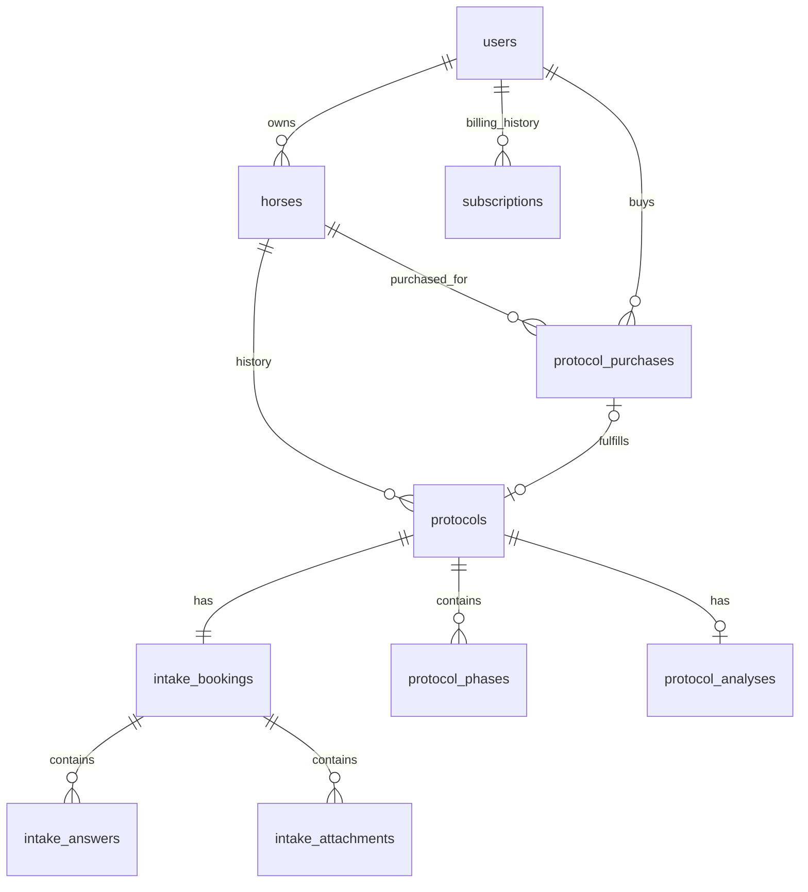

# Protocol and intake ownership

A horse has many protocols over time. Each protocol has exactly one intake, and every intake belongs to exactly one protocol for the same horse. Only one protocol with `status = active` can exist for a horse. Completed protocols retain their own intake answers, analyses, phases and history. Draft, paused and archived protocols are not active.

A protocol purchase creates an unpublished `draft` protocol and its intake in one transaction. Its template stays empty until a therapist configures it. The intake review links directly to this protocol. Creating a protocol through the admin also creates its intake. A protocol cannot be reassigned to another horse, and an intake cannot be reassigned to another protocol/account/horse through the application.

One account subscription unlocks all app features. Existing paid plan identifiers remain compatible but have identical access rights; `free` does not grant access. An inactive or expired subscription shows only the renewal page and blocks protected API calls. The app uses synced expiry dates while offline. Library credits and previously purchased library unlocks remain separate and are preserved when a subscription expires.

Protocols are separate purchases for a specific owned horse. There is no lifetime included-intake limit. `ProtocolPurchases::prepare()` snapshots the backend-configured price (default €147) and `fulfillVerifiedPayment()` atomically creates one protocol/intake pair only after a trusted payment adapter verifies the amount, currency and payment reference. Retries return the same purchase; deleting a protocol does not make its receipt reusable. A paid order can be fulfilled if the subscription expired during checkout. Legacy protocols and intakes remain accessible after renewal without another purchase. The previous entitlement tables remain historical records only.

Configure the price for new protocols under **Protocol kopen** in the backend, in eurocents. Changing it does not reprice existing quotes. No live payment provider is connected yet: both protocol checkout and subscription renewal must be integrated before customers can pay online. The former bundled upgrade handler is fail-closed and the test-only purchase bypass is removed.

Nutrition, dosage calculation, preview and the customer dashboard read the selected protocol's intake, never an unrelated intake on its horse. PowerSync publishes draft identity/status so purchases are visible immediately after syncing, while clinical content still requires publication. Home lists purchased protocols for the selected horse, and intake links carry the exact booking ID.

An intake already stored on the device opens and saves locally for an active subscriber without an access/start request. Pending changes stay queued if access expires and upload after renewal, subject to ownership checks. The app waits for a purchased intake to sync instead of creating a local substitute. Photo/file uploads still require a connection.

## Database guarantees

- `intake_bookings.protocol_id`: required, unique FK to `protocols.id`, cascade delete.
- `intake_bookings.horse_id`: required; a composite FK `(protocol_id, horse_id)` ensures agreement with the protocol's horse.
- `protocols_one_active_per_horse`: partial unique index on `horse_id WHERE status = 'active'`, including unpublished protocols.
- Deferred constraint triggers ensure that no transaction leaves a protocol without its intake. Direct SQL writes are covered as well as model writes.
- Application validation and a horse-row lock provide actionable activation errors, including bulk restore; the database index handles concurrent/direct writes.
- Deleting a protocol deletes its intake/answers/attachment records. Attached files are removed after commit. A standalone intake delete is allowed only for an unconfigured draft and deletes that draft too. A configured protocol must be deleted explicitly. Horse deletion cascades both together.

## Existing databases and deployment

Deploy normally with `./deploy-to staging`. No manual SQL or separate seeding step is needed for the staging inventory inspected on 2026-10-14. The deployment script takes a database backup and enables maintenance before `artisan migrate --force`. The migrations are included in the packaged backend.

1. `2026_10_14_000001_link_intakes_to_protocols` adds the nullable unique protocol FK and permits template-free drafts. This step is additive and remains compatible with the previous release if reconciliation fails.
2. `2026_10_14_000002_enforce_protocol_intake_invariants` locks the affected tables and performs the backfill, audit and constraint installation in one transaction. A failure rolls back all its data changes and audit entries. The helper in `database/migrations/support/protocol-intake-backfill.php` uses raw queries, so it sends no notifications and does not run model events or grant entitlements.
3. An unambiguous unmatched protocol/intake pair is linked. Unmatched intakes with no remaining protocol receive a draft protocol (archived for cancelled intakes). Protocols with no remaining intake receive an explicitly empty, unsubmitted draft intake, with a note explaining its migration origin. Answers are never copied or invented. Multiple unmatched candidates, horseless intakes and unexpected duplicate active protocols stop the transaction with IDs for review.
4. The approved Nova exception is fixed by exact IDs, not by choosing whichever protocol is newest. The expected legacy records, ownership, statuses and absence of intake answers/attachments are checked again at migration time. Changed history stops deployment for review.
5. Each created record, link and status change is recorded in `audit_logs` with action `protocol_intake_migrated`, including before/after values and a reason. Existing intake content, timestamps, attachment paths and legacy entitlement IDs remain unchanged.

The additional `2026_10_15` migrations create durable protocol purchase receipts, add the configurable protocol price and update existing marketing copy, then refresh library access under the single-subscription rule. They do not charge customers, change subscription billing amounts, manufacture historical purchases or delete existing credit unlocks. Deploy the matching client and sync rules with these migrations; older clients are not compatible with the new purchase-only intake flow.

### Approved staging mapping

| Existing record | Migration result |
| --- | --- |
| Nova’s plan (`01a0639e-e9d5-7179-af49-2c2b8ac6b73c`) | Archived; previous status recorded as active |
| Nova 2.0 (`01a07784-f09e-7322-a90c-69ea51f17864`) | Remains active; receives a new empty draft intake |
| Nova’s cancelled intake (`019ff162-1f74-7079-bc9d-b1e04a183b48`) | Keeps its ID and cancelled status; linked to Nova’s plan |
| R’s paused protocol and submitted intake | Linked together; submitted answers preserved |
| Seven other intake-only horses | One draft protocol per existing intake |

At inspection there were 3 protocols and 9 intakes. With that inventory unchanged, migration produces 10 protocol/intake pairs: 1 active, 1 paused, 1 archived and 7 draft protocols. New unambiguous intake records created before deployment are also handled automatically.

After deployment, run from the active release:

```sh
php artisan protocols:audit-intakes
php artisan migrate:status
```

The audit must print `[]` and exit successfully. Publish the matching `backend/powersync/sync_rules.yaml` to the separately managed PowerSync service as part of the release; the web deployment script does not manage that service. Verify intake start, draft editing, publication, rejected second activation and historical nutrition isolation.

### Failure and rollback

An unexpected data conflict aborts reconciliation; the old code may resume against the additive schema. Once the required relationship is installed, older releases cannot safely write to it. The deployment compatibility guard therefore refuses explicit rollback to pre-change code. If activation fails after successful enforcement and restores incompatible old code, it leaves maintenance enabled and prints the retained database backup path. Restore the matching backup and code together, or deploy compatible code, before reopening traffic. No database restore happens automatically.

Schema `down()` preserves created records, audit entries and archived history; it is not a data rollback. Retrying enforcement after a schema-only rollback does not create duplicate protocol/intake pairs. Do not drop the link column after new history has been written, because that discards the associations needed to identify historical pairs.

## Core relationship



See [the complete database diagram](data-model.html) and [the complete schema reference](data-model.md) for all tables.
